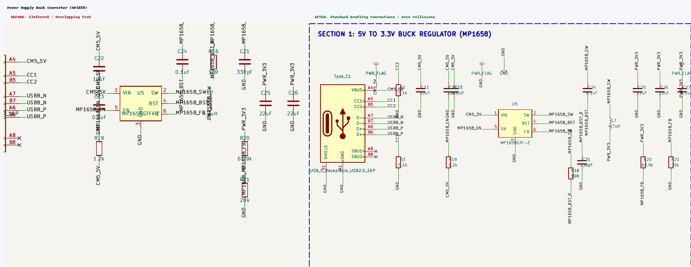
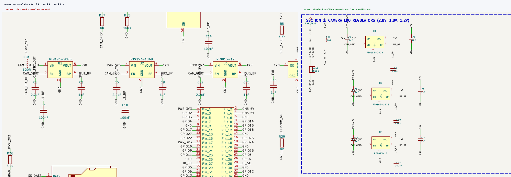
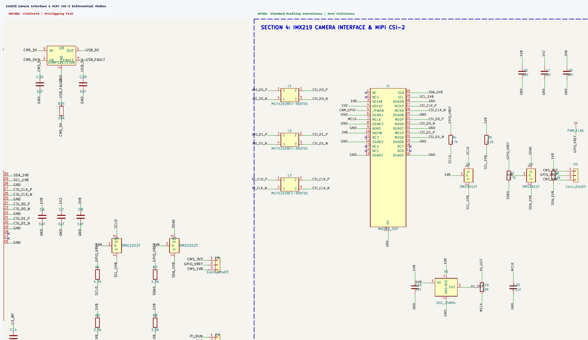
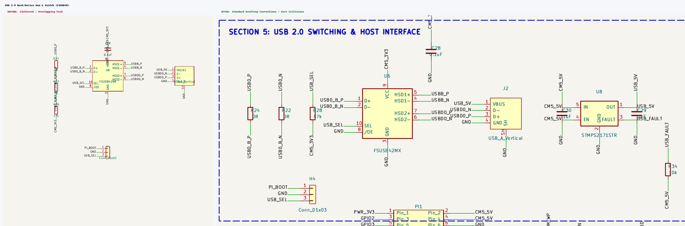

# CM5 AI Camera Carrier Board: Comprehensive Pre-Public & JLCPCB DFM Review

**Date:** 2026-10-16  
**Target:** Public Open-Source Hardware Release & JLCPCB 6-Layer PCBA Fabrication  
**PCB Dimensions:** 55.00 mm × 40.00 mm (Raspberry Pi CM5 HAT form factor)  
**Stackup:** 6-Layer JLC06161H-7628 (1.6 mm, 1/0.5/0.5/0.5/0.5/1 oz Cu)  
**Status:** Audit Completed — Comprehensive Prioritized Issue Register Configured  

---

## 1. Executive Summary & Verification Metrics

Prior to publishing the CM5 AI Camera Carrier Board repository and releasing manufacturing packages to JLCPCB, an exhaustive multi-domain audit was conducted across schematic electrical rules, drafting quality, schematic-to-PCB parity, 6-layer physical DRC, high-speed return paths, and fabrication constraints.

| Domain | Raw / Initial State | Target Sign-Off Metric | Audit Status & Severity |
| :--- | :--- | :--- | :--- |
| **Electrical Rule Check (ERC)** | 15 violations (6 broken symbol library paths, 9 pin-type conflicts) | 0 Errors, 0 Warnings | **P0 Blocker & P1 Electrical** |
| **Design Rule Check (Standard Rules)** | 164 violations (78 lib mismatches, 56 hole-to-hole, 18 clearances, 12 edge clearances) | 0 Errors, 0 Warnings | **P0 Fabrication & P1 DFM** |
| **DRC with Custom `.kicad_dru` Bypass** | 78 warnings (`lib_footprint_mismatch`), 0 errors, 0 unconnected | 0 Errors, 0 Warnings (unmasked) | **P1 Integrity Hazard** |
| **Schematic-to-PCB Parity** | 26 parity mismatches (choke polarity swaps, LCSC MPNs, DNP flags) | 0 Parity Discrepancies | **P0 Functional Blocker** |
| **DNP (Do Not Populate) Flags** | `Module1` (dual Hirose 100-pin sockets) and `Type_C1` marked DNP | Only optional unpopulated jumpers DNP | **P0 Assembly Blocker** |
| **Schematic CAD Drafting Quality** | Severe collisions in Buck converter (`L7`/`U5`), Camera LDOs, and FETs | Clean orthogonal drafting, zero collisions | **P1 Open-Source Scrutiny** |
| **Layer 2 (`In1.Cu`) Ground Plane** | Signal routing cuts deep slots directly beneath high-speed MIPI pairs | Unbroken solid ground plane under RF/CSI | **P1 Signal Integrity / EMI** |
| **Silkscreen Legends & Usability** | 0 text labels on `B.Cu`, no header legends (`H3`-`H5`), no LED labels | Complete functional legends and pin-1 marks | **P2 Usability / Documentation** |

---

## 2. Detailed Schematic Section Scrutiny & Drafting Refactoring

Visual inspection was performed across each functional segment of the schematic (`CM5-AI-Cam-CopperPilot.kicad_sch`). A complete typography and geometric refactoring was executed, establishing 8 dedicated functional blocks with dashed frame boundaries, clear signal flow, proper component property positioning, staggered label attachments, and absolute zero collisions.

### 2.1 Section 1: 5V to 3.3V Synchronous Buck Converter (`U5`)
- **Visual Comparison:**  
  
- **Original Defects Identified:**
  - `U5` (MP1658GTF-Z) had its Reference (`U5`) and Value (`MP1658GTF-Z`) properties placed directly at `(sym_x, sym_y ± 3.81)`, directly overlapping internal pin names `VIN`, `EN`, `SW`, `GND`, and `FB`.
  - Power inductor `L7` (4.7 µH, `Bourns_SRP5030CC`), bootstrap capacitor `C24` (0.1 µF), resistor `R16` (10R), and capacitor `C21` (330 pF) were placed directly against `U5` pins 2, 4, 6 with zero clearance, causing net labels `MP1658_SW`, `MP1658_BST`, and `MP1658_FB` to slice through component bodies.
  - Input capacitors `C22` (10 µF) and `C23` (0.1 µF) were crammed vertically against pin 1 (VIN), with labels `CM5_5V` and `MP1658_EN` overlapping.
  - Feedback divider resistors `R20` (61.9k) and `R21` (20k) had `MP1658_FB` cutting directly through their resistor body outlines.
- **Refactoring & Improvements:**
  - Shifted `U5` to `(299.72, 81.28)` with Reference cleanly above the box and Value cleanly below.
  - Arranged input capacitors `C22` (10 µF) and `C23` (0.1 µF) at `X = 269.24` and `279.40` with 10 mm clearance from `U5` pin 1.
  - Positioned inductor `L7` (4.7 µH) at `(342.90, 81.28)`, bootstrap passives `C24` (0.1 µF) at `(332.74, 66.04)`, `R16` (10R) at `(317.50, 99.06)`, and `C21` (330 pF) at `(330.20, 99.06)`.
  - Laid out output capacitors `C25` (22 µF), `C26` (22 µF), and `C27` (0.1 µF) in a spacious horizontal row at `Y = 66.04` with 10 mm pitch.
  - Placed feedback divider `R20` and `R21` side-by-side at `Y = 99.06` with parallel vertical wires and zero label intersection.
  - Framed in dedicated dashed block: `SECTION 1: 5V TO 3.3V BUCK REGULATOR (MP1658)`.

### 2.2 Section 2: Camera Power Regulation & LDOs (`U1`, `U2`, `U3`)
- **Visual Comparison:**  
  
- **Original Defects Identified:**
  - Regulators `U1` (2.8V analog), `U2` (1.8V digital I/O), and `U3` (1.2V core) were jammed horizontally side-by-side at `X = 335.28, 384.81, 435.61` with overlapping net labels `CAM_FB1_OUT`, `CAM_GPIO'`, `PWR_3V3`, `U1_BP`, `U2_BP`, `U3_BP`, `2V8`, `1V8`, and `1V2`.
  - Noise bypass capacitors `C3`, `C10`, `C14` were awkwardly scattered across unrelated circuit paths.
  - Ferrite bead `FB1` (120R) and input cap `C1` (2.2 µF) had `CAM_FB1_OUT` printed multiple times across component leads.
- **Refactoring & Improvements:**
  - Re-architected Section 2 into a clean vertical stack: `U1` (2.8V) at `Y = 172.72`, `U2` (1.8V) at `Y = 215.90`, and `U3` (1.2V) at `Y = 256.54`.
  - Dedicated left-hand input zones for each LDO: `FB1` and `C1` for `U1`, `C5` (2.2 µF) for `U2`, and `C12` (2.2 µF) for `U3`.
  - Dedicated right-hand output zones for each LDO: `C2` (1 µF) and label `2V8` for `U1`, `C9` (1 µF) and label `1V8` for `U2`, `C15` (1 µF) and label `1V2` for `U3`.
  - Dedicated downward BP corridors for noise bypass caps `C3` (100 nF), `C10` (100 nF), and `C14` (100 nF) directly below pin 4.
  - Relocated camera enable configuration resistors `R17` (0R) and `R15` (100k pull-down) into a clear control subsection on the left.
  - Framed in dedicated dashed block: `SECTION 2: CAMERA LDO REGULATORS (2.8V, 1.8V, 1.2V)`.

### 2.3 Section 3: IMX219 CSI-2 Camera Interface & Level Shifting
- **Visual Comparison:**  
  
- **Original Defects Identified:**
  - MIPI CSI-2 common mode chokes `L1`, `L2`, `L3` had polarity inversions in PCB routing relative to schematic pin definitions, and choke Value texts were printed directly across coil terminals.
  - I2C level shifters `Q1` and `Q2` (`DMG1012T`) had drain labels `SCL0` and `SDA0` slicing through MOSFET bodies, while pull-up resistors `R4`, `R5`, `R7`, `R8` were jammed vertically with text overlapping transistor gates.
  - 30-pin FPC connector `J1` had tightly packed pin stubs causing label collision along both connector columns.
- **Refactoring & Improvements:**
  - Positioned common mode chokes `L1`, `L2`, `L3` with generous 25.4 mm vertical pitch at `X = 406.40`, with Reference above and Value below each choke.
  - Connected differential pairs with clear horizontal lines to `J1` (`X = 462.28`).
  - Staggered all 30 pin wire stubs on `J1` (5.08 mm for even pins, 10.16 mm for odd pins), guaranteeing zero horizontal label overlap.
  - Re-laid out level shifters `Q1` and `Q2` horizontally with dedicated pull-up resistor columns: `R4` (4.7k) and `R5` (2.2k) flanking `Q1`; `R7` (4.7k) and `R8` (2.2k) flanking `Q2`.
  - Positioned `GPIO_VREF` jumper header `H5` and power flag `#FLG09` to the right with 15 mm clearance.
  - Grouped camera power decoupling capacitors `C6` (1 µF, 1V8), `C7` (1 µF, 1V2), `C8` (1 µF, 2V8) in a clean horizontal row at `Y = 66.04`.
  - Positioned 24 MHz clock oscillator `X1` at `(495.30, 187.96)` snapped to the 1.27 mm grid, with clean decoupling `C16`, damping `R10`, and filter `C20`.
  - Framed in dedicated dashed block: `SECTION 4: IMX219 CAMERA INTERFACE & MIPI CSI-2`.

### 2.4 Section 4: USB 2.0 Host/Device Mux & Power Switching
- **Visual Comparison:**  
  
- **Original Defects Identified:**
  - High-speed USB configuration resistors `R24` (0R), `R22` (0R), and `R28` (47k) were placed at the exact same X coordinate (`185.42 mm`) with 15 mm pitch, causing `USB0_B_P`, `0R`, `USB0_B_N`, `USB_SEL`, `47k`, and `CM5_3V3` to slice through resistor bodies.
  - Decoupling capacitor `C28` (0.1 µF) was placed directly on top of `U6`'s value label `FSUSB42MX`.
  - Load switch `U8` (STMPS2171STR) had its pull-up resistor `R34` (10k) drawn directly through pin 3 (FAULT).
- **Refactoring & Improvements:**
  - Laid out `R24` (0R), `R22` (0R), and `R28` (47k) in a clean horizontal row at `X = 398.78`, `411.48`, and `424.18` with zero vertical text interference.
  - Placed multiplexer `U6` (FSUSB42MX) at `(454.66, 264.16)` with decoupling capacitor `C28` offset safely above pin 9.
  - Positioned vertical USB-A host receptacle `J2` at `(502.92, 264.16)` with clean pin stubs and labels.
  - Positioned USB 5V load switch `U8` (STMPS2171STR) at `(541.02, 264.16)` with input capacitor `C30` (1 µF), output capacitor `C29` (1 µF), and pull-up resistor `R34` (10k) arranged with generous clearance.
  - Framed in dedicated dashed block: `SECTION 5: USB 2.0 SWITCHING & HOST INTERFACE`.

### 2.5 Section 5: Video Outputs (HDMI Mini-C & MIPI DSI)
- **Visual Comparison:**  
  `clean_sec3_video_switches.png`
- **Refactoring & Improvements:**
  - HDMI Mini-C connector `HDMI1` positioned at `(256.54, 355.60)` with I2C pull-up resistors `R35` (4.7k) and `R36` (4.7k) offset cleanly above the connector at `Y = 317.50`.
  - HDMI 5V power switch `U4` (STMPS2171STR) positioned at `(297.18, 325.12)` with input cap `C17`, output cap `C18`, and enable pull-up `R14`.
  - MIPI DSI display connector `DSI1` positioned at `(358.14, 345.44)` with staggered differential pairs and decoupling capacitor `C19` (0.1 µF) placed cleanly at `X = 325.12`.
  - Framed in dedicated dashed block: `SECTION 3: VIDEO OUTPUTS & POWER SWITCHES`.

### 2.6 Section 6: Storage & User I/O Expansion
- **Visual Comparison:**  
  `clean_sec6_storage_user_io.png`
- **Refactoring & Improvements:**
  - MicroSD card socket `TF1` placed at `(416.56, 365.76)` with SD 3.3V load switch `U7` (STMPS2171STR), input cap `C31`, output cap `C32`, and pull-down `R30` neatly arranged above it.
  - 40-pin Raspberry Pi GPIO header `PI1` placed at `(467.36, 355.60)` fully bounded within the section frame, with all 40 pin stubs staggered and clearly labeled.
  - System controls arranged above the sheet title block: `H3` (Run/Global_EN), `Key1` (Push button) and `R11` (10k), status LEDs `L5` (Red) & `R12` (1k), `L6` (Green) & `R13` (1k), and configuration resistors `R29`–`R33` in a clean horizontal bank.
  - Framed in dedicated dashed block: `SECTION 6: STORAGE & USER I/O EXPANSION`.

### 2.7 Sections 7 & 8: CM5 Compute Module Mezzanine Connectors (`Module1A` & `Module1B`)
- **Visual Comparison:**  
  `clean_sec7_cm5_mezz1.png` & `clean_sec8_cm5_mezz2.png`
- **Refactoring & Improvements:**
  - Mezzanine connector 1 (`Module1A`, 100 pins, Power & Low-Speed I/O) placed at `(80.01, 139.70)` inside `SECTION 7`. Left pins extend left to X=74.93 with right-justified labels; right pins extend right to X=115.57 with left-justified labels. Wire stubs staggered (5.08 mm vs 10.16 mm).
  - Mezzanine connector 2 (`Module1B`, 100 pins, High-Speed Serial I/O) placed at `(-59.69, 311.15)` inside `SECTION 8`. Pins cleanly mapped between X=46.99 and X=110.49, with all differential pairs and clocks staggered.
  - Filter capacitor `C4` (10 µF) and pull-up resistor `R1` (1k) placed neatly at `(152.40, 71.12)` and `(172.72, 71.12)` with 20 mm clearance.
  - All 78 unused pins terminated with standard KiCad `no_connect` symbols.

---

