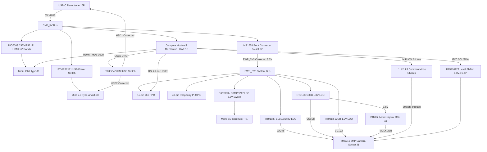

# CM5 AI Camera Carrier Board - JLCPCB PCBA Manufacturing Preparation Plan

## Architecture & Subsystem Interconnect Map

---

## Technical Context & Audit References

The plan incorporates complete findings from four comprehensive research notes:
1. **JLCPCB 6-Layer Rules & Constraints:** [`./.copperpilot/notes/jlcpcb-6layer-rules-spec.md`](./.copperpilot/notes/jlcpcb-6layer-rules-spec.md)
2. **LCSC SMT BOM & Component Sourcing Audit:** [`./.copperpilot/notes/cm5-carrier-lcsc-bom-audit.md`](./.copperpilot/notes/cm5-carrier-lcsc-bom-audit.md)
3. **Schematic Pinout & Defect Register:** [`./.copperpilot/notes/schematic-pinout-defect-register.md`](./.copperpilot/notes/schematic-pinout-defect-register.md)
4. **PCB Layout, Footprint & DRC Resolution Strategy:** [`./.copperpilot/notes/pcb-drc-footprint-resolution.md`](./.copperpilot/notes/pcb-drc-footprint-resolution.md)

---

## Detailed Implementation Phases

### Phase 1: Symbol & Schematic Defect Rectification

1. **FSUSB42UMX (U6) Symbol & Circuit Correction:**
   - Redefine `FSUSB42MX` symbol in `CM5.kicad_sym` to match physical UMLP-10 pinout:
     - Pin 1: `VCC` (power_in)
     - Pin 2: `SEL` (input)
     - Pin 3: `D+` (bidirectional)
     - Pin 4: `D-` (bidirectional)
     - Pin 5: `GND` (power_in)
     - Pin 6: `HSD1-` (bidirectional)
     - Pin 7: `HSD2+` (bidirectional)
     - Pin 8: `HSD2-` (bidirectional)
     - Pin 9: `HSD1+` (bidirectional)
     - Pin 10: `/OE` (input)
   - Rewire schematic: Pin 1 to `/CM5_3V3`, Pin 5 to `GND`, Pin 10 to `GND` (enable switch), Pin 2 to `/USB_SEL`.
   - Wire Pin 3 to `/USB0_B_P`, Pin 4 to `/USB0_B_N`.
   - Wire Port 1 (USB-C): Pin 9 to `/USBB_P`, Pin 6 to `/USBB_N`.
   - Wire Port 2 (USB-A Host): Pin 7 to `/USBD0_P`, Pin 8 to `/USBD0_N`.
   - Add pull-up option on `/USB_SEL` or restore jumper logic on `H4` to allow switching to USB-A host.

2. **MP1658 Buck Converter (U5) Overvoltage & Pinout Fix:**
   - Correct feedback divider: Replace R20 (100k) with `61.9k 1%` (0402). Combined with R21 (20k 1%), output voltage is:
     $$V_{OUT} = 0.807V \times \left(1 + \frac{61.9k}{20k}\right) = 3.305V$$
     (prevents catastrophic 4.84V overvoltage onto `PWR_3V3`).
   - Fix bootstrap circuit: Disconnect R16 (10R) and C21 (1uF) from BST and GND. Connect C24 (0.1uF 16V X7R) strictly between Pin 4 (BST) and Pin 2 (SW).
   - Ensure symbol pins match physical land pattern (Pin 1=VIN, Pin 2=SW, Pin 3=GND, Pin 4=BST, Pin 5=EN, Pin 6=FB).

3. **DIO7003 / STMPS2171 Load Switches (U4, U7, U8) Pinout Alignment:**
   - Update `DIO7003HCST5` symbol in `CM5.kicad_sym`: Pin 1=EN (input), Pin 2=GND (power_in), Pin 3=OUT (power_out), Pin 4=FLG (open_collector), Pin 5=IN (power_in).
   - Rewire U4: Pin 5 to `/CM5_5V`, Pin 4 to `/HDMI_5V_EN` (pulled to 5V via R14), Pin 3 to `/HDMI_5V` output.
   - Rewire U7: Pin 5 to `/PWR_3V3`, Pin 4 to `/SD_PWREN`, Pin 3 to `/SD_3.3V` output.
   - For U8 (STMPS2171STR): Verify SOT-23-5 standard pinout (Pin 1=OUT, Pin 2=GND, Pin 3=FAULT, Pin 4=EN, Pin 5=IN).

4. **Common-Mode Chokes (L1, L2, L3) CSI Signal Path Correction:**
   - Update `MCF1210BF2-900T01` symbol so Coil A connects Pin 1 to Pin 4, and Coil B connects Pin 2 to Pin 3.
   - Prevents P-to-N dead short across differential pairs `CAM0_D0_P/N`, `CAM0_D1_P/N`, and `CAM0_CLK_P/N`.

5. **Strapping Resistors Populated to GND:**
   - Mark R29 (Pin 20 `EEPROM_WP`), R31 (Pin 89 `WL_DIS#`), R32 (Pin 91 `BT_DIS#`), and R33 (Pin 101 `USB0_ID`) as DNP (Do Not Populate) in schematic properties.
   - Mark R1 (`SD_VDD_OVERRIDE`) as DNP.

6. **I2C Level Shifter & Pull-ups:**
   - Change footprint for Q1 and Q2 from `Texas_DRT-3` to standard `SOT-523` (or `SOT-23-3`).
   - Remove redundant pull-ups R4 and R7 or disconnect from `GPIO_VREF`.

---

### Phase 2: LCSC BOM Integration & ERC Cleansing

1. **LCSC Part Number & MPN Enrichment:**
   - Embed `LCSC` property into every component in `CM5-AI-Cam-CopperPilot.kicad_sch` using the verified audit table:
     - U1 (2.8V LDO): `C114059` (BL9193-28BAPRN)
     - U2 (1.8V LDO): `C27416` (RT9193-18GB)
     - U3 (1.2V LDO): `C7434207` (RT9013-12GB)
     - U4, U7, U8 (Power Switches): `C157437` (STMPS2171STR)
     - U5 (Buck Converter): `C9900009837` (MP1658GTF-Z) or equivalent SOT-23-6 buck
     - U6 (USB Switch): `C11145` (FSUSB42UMX)
     - Q1, Q2 (MOSFETs): `C20512` (DMG1012T-7)
     - X1 (24MHz OSC): `C717686` (OT322524MJBA4SL)
     - L1, L2, L3 (Chokes): `C49073870` (ACM1210-900-2P-T01)
     - L7 (4.7uH Inductor): `C840574` (NRS5030T4R7MMGJ)
     - Module1 (DF40 Mezzanine): `C597931` (DF40C-100DS-0.4V(51) x2)
     - J1 (IMX219 Socket): `C6539772` (DF37NB-30DS-0.4V(75))
     - Type_C1 (USB-C 16P): `C3020560` (USB4105-GF-A)
     - TF1 (MicroSD): `C91145` (TF-01A)
     - HDMI1 (Mini-HDMI): `C2013978` (2013978-2)
     - DSI1 (15-pin FPC): `C2914074` (1.0K-FX-15PWB)
     - PI1 (40-pin GPIO): `C50980` (2x20 2.54mm header)
     - Basic Passives: `C17168` (0R 0402), `C25744` (10k 0402), `C25900` (4.7k 0402), `C1525` (100nF 0402), `C52923` (1uF 0402), `C15850` (10uF 0805), `C45783` (22uF 0805).

2. **Schematic ERC Clearance:**
   - In `ComputeModule5-CM5`, set Pin 86 and Pin 90 to `passive`.
   - Remove spurious `#FLG03` through `#FLG08` PWR_FLAGs on regulator outputs.
   - Run `kicad-cli sch erc` to confirm zero violations.

---

### Phase 3: JLCPCB 6-Layer Rules & Board Setup

1. **Configure `.kicad_pro` Board Settings:**
   - Apply JLCPCB 6-layer manufacturing rules:
     - `min_track_width`: `0.09 mm`
     - `min_clearance`: `0.10 mm`
     - `min_through_hole_diameter`: `0.20 mm`
     - `min_via_diameter`: `0.40 mm`
     - `min_via_annular_width`: `0.10 mm`
     - `min_hole_clearance`: `0.20 mm`
     - `min_copper_edge_clearance`: `0.30 mm`
     - `min_silk_clearance`: `0.15 mm`
     - `solder_mask_to_copper_clearance`: `0.00 mm` (1:1 CAD)

2. **Net Class Setup (JLC06161H-3313 Stackup):**
   - `Default`: Track `0.15 mm`, Clearance `0.15 mm`, Via `0.50/0.30 mm`.
   - `Power`: Track `0.50 mm`, Clearance `0.20 mm`, Via `0.65/0.35 mm`.
   - `HighSpeed_90R`: Track `0.125 mm`, Clearance `0.15 mm`, Diff Pair W=`0.125 mm`, Gap=`0.127 mm`, Via `0.45/0.25 mm`.
   - `HighSpeed_100R`: Track `0.105 mm`, Clearance `0.15 mm`, Diff Pair W=`0.105 mm`, Gap=`0.150 mm`, Via `0.45/0.25 mm`.

---

### Phase 4: PCB Synchronization, Placement & DFM Enhancements

1. **Synchronize Schematic to PCB:**
   - Execute schematic-to-PCB synchronization. Purge all 45 scrambled mockup footprints and instantiate all 103 legitimate footprints directly from `CM5.pretty`.

2. **Placement Execution:**
   - Bottom side (`B.Cu`): Dual Hirose DF40 mezzanine connectors (`Module1`), LDOs (`U1`, `U2`, `U3`), USB switch (`U6`), power switches (`U4`, `U7`), and local passives.
   - Top side (`F.Cu`): IMX219 camera socket (`J1`) centrally located, Mini-HDMI (`HDMI1`), USB-C (`Type_C1`), vertical USB-A (`J2`), MicroSD (`TF1`), 40-pin GPIO (`PI1`), buck regulator (`U5`), inductor (`L7`), and 24MHz crystal (`X1`).
   - SMT Clearances: Ensure passive-to-passive >= `0.35 mm`, IC-to-passive >= `0.50 mm`, IC-to-IC >= `0.80 mm`.

3. **SMT Fiducial Marks:**
   - Place 3 global optical fiducials (1.0 mm round copper pad, 2.0 mm mask opening, 3.0 mm keepout) on `F.Cu` and 3 on `B.Cu` near corners.

---

### Phase 5: Routing & Plane Distribution

1. **High-Speed Differential Pairs:**
   - Route HDMI TMDS differential pairs (100Ω) on `In4.Cu` referenced to `In3.Cu` / `B.Cu` ground plane.
   - Route MIPI CSI-2 and DSI differential pairs (100Ω) straight through common-mode chokes `L1`, `L2`, `L3` to `J1`.
   - Route USB 2.0 differential pairs (90Ω) from `Type_C1` and `J2` through `U6` to `Module1`.

2. **Power & Ground Distribution:**
   - Layer 2 (`In1.Cu`): Dedicated solid `GND` return plane.
   - Layer 3 (`In2.Cu`): Split power planes for `PWR_3V3` and `CM5_5V`.
   - Layer 4 (`In3.Cu`): Dedicated `GND` reference plane.
   - Layer 5 (`In4.Cu`): High-speed signals and auxiliary power rails (`2V8`, `1V8`, `1V2`).
   - Reconnect all 10 broken nets (`/CSI_D0_N`, `/1V2`, `/SDA_1V8`, `/PWR_3V3`, `GND`, `/CM5_5V`).

---

### Phase 6: Final Verification & Manufacturing Artifact Generation

1. **DRC Cleansing:**
   - Refill all zones using `kicad-cli pcb drc --refill-zones`.
   - Run `kicad-cli pcb drc` to verify zero clearance, track width, via diameter, drill, annular ring, or connectivity errors.

2. **Deliverables Generation:**
   - Standard RS-274X / Gerber X2 files for all 6 copper layers, solder masks, silkscreens, and Edge.Cuts.
   - Excellon drill files (PTH and NPTH).
   - JLCPCB SMT BOM (CSV with Ref, Value, Package, LCSC Part Number).
   - JLCPCB Component Placement List / Centroid file (CPL CSV with Ref, Layer, PosX, PosY, Rotation).
