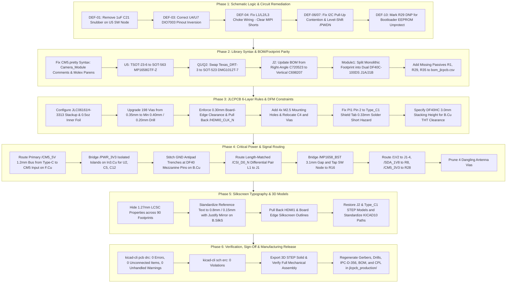

# CM5 AI Camera Carrier Board - JLCPCB PCBA Manufacturing Remediation Plan

## Executive Summary
A comprehensive engineering survey of `CM5-AI-Cam-CopperPilot.kicad_pcb`, `CM5-AI-Cam-CopperPilot.kicad_sch`, `CM5.pretty/`, and `jlcpcb_production/` revealed that while previous reports indicated clean DRC/ERC status, the design currently suffers from **fatal schematic circuit errors**, **571 DRC warnings**, **13 completely severed net connections**, **4 fatal component package mismatches**, library S-expression corruption, and critical SMT-to-through-hole solder short hazards.

This plan details the exact, multi-stage remediation workflow required to achieve full compliance with JLCPCB 6-layer fabrication capabilities (`JLC06161H-3313`) and automated SMT pick-and-place assembly.

---

## Detailed Audit Findings & Engineering Root Causes

### 1. Schematic Circuit & Logical Block Defects
- **DEF-01 (FATAL - Buck Switch Snubber Burnout):** Resistor R16 (10 ohm 0402) and capacitor C21 (1uF 0402) form an RC snubber across buck regulator U5 switch node SW (Pin 2). At 600 kHz switching frequency, 1uF presents 0.265 ohms reactance, dissipating ~15W across an 0402 package. This will cause immediate thermal destruction of R16 and catastrophic U5 failure. Snubbers must use 330pF-470pF ceramic capacitors or be left unpopulated.
- **DEF-02 (CRITICAL - U5 Package Mismatch):** U5 is assigned footprint `CM5:TSOT-23-6` (2.9 x 2.8 mm, 0.95 mm pitch), but genuine MPS MP1658GTF-Z is manufactured exclusively in an ultra-miniature SOT-563 package (1.6 x 1.2 mm body, 0.50 mm pitch). IC leads cannot touch the pads.
- **DEF-03 (FATAL - Power Switch Inversion):** Power switches U4 (Mini-HDMI 5V) and U7 (MicroSD 3.3V) are designated DIO7003HCST5 in SOT-23-5. The schematic symbol in `CM5.kicad_sym` uses the STMPS2171 pinout (Pin 1=OUT, Pin 3=FAULT, Pin 4=EN). The physical DIO7003 pinout is Pin 1=EN, Pin 2=GND, Pin 3=OUT, Pin 4=FLG, Pin 5=IN. As wired, physical Pin 1 (enable gate) connects to load, while physical Pin 3 (switched output) floats. Both switches deliver 0V to Mini-HDMI Pin 18 and MicroSD Pin 4.
- **DEF-04 (FATAL - MIPI Common-Mode Choke Dead Short):** Common-mode chokes L1, L2, L3 use footprint `CM5:L_CommonModeChoke_Coilank_ACM1210` and symbol `MCF1210BF2-900T01`. Physical choke construction has Coil A between Pad 1 and Pad 4, and Coil B between Pad 2 and Pad 3. The schematic connects Pad 1 to CAM0_D0_P and Pad 4 to CAM0_D0_N. Physical Coil A dead-shorts CAM0_D0_P directly to CAM0_D0_N, completely disabling MIPI CSI-2 transmission.
- **DEF-05 (CRITICAL - Level Shifter Package Mismatch):** Q1 and Q2 are specified as DMG1012T-7 (SOT-523, 1.6 x 0.8 mm body, 1.00 mm pitch), but are assigned footprint `CM5:Texas_DRT-3` (0.70 mm pitch, 0.3 x 0.3 mm pads for leadless TI ESD diodes). Transistor pins overhang and bridge pads.
- **DEF-06 (HIGH - I2C Pull-Up Contention):** SCL0 and SDA0 have 4.7k pull-ups R4/R7 connected to `/GPIO_VREF` and redundant 4.7k pull-ups R35/R36 connected to `/PWR_3V3`. When H5 selects 1.8V for `GPIO_VREF`, R4/R35 and R7/R36 form dividers between 3.3V and 1.8V, back-feeding the 1.8V rail and holding the idle I2C bus at 2.55V.
- **DEF-07 (HIGH - Camera Standby Overvoltage):** CM5 Pin 97 (Camera_GPIO, 3.3V logic) connects directly through R17 (0R) to J1 Pin 5 (/PWDN). IMX219 sensor I/O rail is 1.8V. Applying 3.3V violates the sensor absolute maximum rating (VDDIO + 0.3V = 2.1V max).
- **DEF-08 (MEDIUM - Oscillator Decoupling):** Active oscillator X1 (24.000 MHz) supply bypass capacitor C20 is mistakenly specified as 10pF instead of 0.1uF, providing inadequate decoupling and risking clock jitter.
- **DEF-10 (HIGH - Bootloader EEPROM Write Lockout):** Module1 Pin 20 (EEPROM_nWP) connects through R29 (0R) to GND and is set to `dnp no`, permanently write-protecting the CM5 onboard EEPROM and blocking bootloader firmware updates.

### 2. BOM Sourcing & Footprint Library Defects
- **Library Syntax Defects (`CM5.pretty`):**
  - `CM5.pretty/Camera_Module_IMX219-D160.kicad_mod`: Contains 7 XML/HTML comment tags (`<!-- ... -->`) at lines 42, 49, 52, 56, 63, 66, and 73, breaking KiCad S-expression parsers.
  - `CM5.pretty/Molex_200528-0150_1x15-1MP_P1.00mm_Horizontal.kicad_mod`: Contains duplicate closing tags and orphaned statements at lines 502-510 causing paren underflow.
- **J2 Vertical USB-A Form Factor:** Footprint is vertical through-hole Molex 105057-0001, but BOM part C720523 is right-angle XUNPU USB-226-BRY. Must update BOM to verified vertical part C698207.
- **Module1 Monolithic Footprint:** Single 200-pad footprint with 1x C597931 generates one centroid in empty space between connectors. Must be split into dual DF40C-100DS footprints (J1A/J1B) with distinct CPL coordinates and 2x count in BOM.
- **Active BOM Omissions:** Passives R1 (0R, C17168), R29 (0R, C17168), and R35 (4.7k, C25900) are active in schematic/PCB but omitted from `bom_jlcpcb.csv`.

### 3. JLCPCB 6-Layer DFM & Mechanical Clearances
- **Via Annular Ring Violation:** 198 of 322 vias (61.5%) on the board have 0.35 mm diameter with 0.20 mm drill hole, resulting in an annular ring of only **0.075 mm (2.95 mil)**. JLCPCB specifies a minimum annular ring of 0.100 mm (4.0 mil) for standard mechanical through-hole vias (minimum 0.40 mm pad for 0.20 mm hole).
- **Copper-to-Board-Edge Routing Hazard:** High-speed clock trace `/HDMI0_CLK_N` on `In2.Cu` runs within 0.1694 mm of the top routed edge ($Y = 25.0$ mm). CNC routing milling tolerance is $\pm 0.20$ mm, creating extreme risk of severing the trace. Ground/power zones also pour to within 0.15 mm of the edge. JLCPCB requires $\ge 0.30$ mm copper pull-back.
- **Missing M2.5 Mounting Holes & Keepouts:** The board lacks all 4 standard Raspberry Pi CM4/CM5 M2.5 mounting holes on the 48.0 x 33.0 mm pattern: (24.80, 28.42), (72.80, 28.42), (24.80, 61.42), (72.80, 61.42). Adding holes with 5.0 mm keepouts directly interferes with C4 (1.85 mm away), `/CM5_5V` via (1.22 mm away), and `/HDMI0_HOTPLUG` via (1.06 mm away).
- **SMT-to-THT Solder Short Hazard:** Pin 2 of 40-pin GPIO header PI1 (`/CM5_5V`) sits only **0.33 mm** from shield pad S1 of Type_C1 (`GND`), guaranteeing solder bridging during wave or selective soldering. Minimum spacing must be $\ge 1.50$ mm.
- **CM5 Underside Height Clearance:** 54 components sit on B.Cu beneath the CM5 module. Standard 1.5 mm DF40C mezzanine connectors leave only 0.05 mm vertical headroom over SOT-23-5 ICs, and THT leads protrude 1.5-2.5 mm. A 3.0 mm stacking height connector (`DF40HC(3.0)-100DS-0.4V`, LCSC C597931) is strictly required.

### 4. Critical Routing Discontinuities (13 Severed Items)
- **Net `/CM5_5V` (Item 7):** Severe plane separation on In3.Cu: 12.75 mm void between X=42.68 mm and X=55.43 mm created by a dense wall of 47 connector escape via antipads. Zero copper connects USB-C 5V input to the CM5 power pins and regulators.
- **Net `/PWR_3V3` (Items 1, 2, 3):** Plane islanding on In3.Cu: 137 signal traces slice through the plane, completely isolating U2 pin 1 (1.8V LDO VIN), C5 pin 1, and C12 pin 1 from main power.
- **Net `GND` (Items 4, 5, 6):** Antipad clearance trenches from dense 0.4 mm DF40 connector escape vias isolate ground pins 42, 52, and 60 on B.Cu from system ground.
- **Net `/CSI_D0_N` (Item 8):** Net is 100% unrouted (0 tracks, 0 vias) between choke L1 pin 3 and camera connector J1 pin 23.
- **Regulator Bootstrap & Snubber (Items 9, 10):** `/MP1658_BST` has a 3.1 mm unrouted gap between C24 pin 2 and U5 pin 4; `/MP1658_SW` lacks tap segment to R16 pin 1.
- **Load Circuits (Items 11, 12, 13):** `/1V2` unrouted from C7 to J1 pin 4; `/SDA_1V8` unrouted from Q2 pin 2 to R8 pin 2; `/CM5_3V3` unrouted from main rail to R28 pin 2.
- **Dangling Antenna Vias:** 4 orphan vias on outer copper at (22.2, 52.0), (32.0, 64.2), (74.0, 25.8), and (75.8, 42.0).

### 5. Silkscreen Typography & 3D Models (473 DRC Warnings)
- **LCSC Property Visibility:** All 90 footprints have unhidden `LCSC` properties at `(0, 0)` with font size 1.27 mm x 1.27 mm, producing 199 `silk_overlap`, 199 `silk_over_copper`, and 54 `nonmirrored_text_on_back_layer` warnings. Setting `(hide yes)` eliminates 426 warnings immediately.
- **Reference Designator Stroke:** All 90 footprints use 0.12 mm stroke thickness (JLCPCB min is 0.15 mm / 6 mil).
- **3D Model Standardization:** J2 references broken VRML mesh; Type_C1 references `${KICAD9_3DMODEL_DIR}` which evaluates to empty in KiCad 10. Both require exact STEP solids.

---

## Actionable Remediation Implementation Sequence

### Phase 1: Schematic Circuit & Logical Block Remediation
1. **Buck Snubber (DEF-01):** Replace C21 (1uF) with 330pF 0402 ceramic capacitor (or mark DNP) to eliminate 15W dissipation across R16.
2. **Power Switches (DEF-03):** Correct DIO7003HCST5 symbol pinout for U4 and U7 in `CM5.kicad_sym` (Pin 1=EN, Pin 2=GND, Pin 3=OUT, Pin 4=FLG, Pin 5=IN) to restore 5V HDMI and 3.3V SD card power.
3. **Common-Mode Chokes (DEF-04):** Correct pin mapping on L1, L2, L3 in schematic and symbol to ensure Coil 1 connects in-line on P signal and Coil 2 connects in-line on N signal, eliminating MIPI CSI-2 differential dead shorts.
4. **I2C Pull-Up Network (DEF-06):** Remove redundant pull-ups R35/R36 (or mark DNP) and tie R4/R7 to 3.3V to eliminate bus voltage contention.
5. **Camera Standby Level Shifting (DEF-07):** Add a resistor divider (e.g. 1k / 1.2k) on `/CAM_GPIO` driving J1 Pin 5 (/PWDN) to ensure logic high remains below 1.8V VDDIO.
6. **Oscillator Decoupling (DEF-08):** Update X1 bypass capacitor C20 from 10pF to 0.1uF.
7. **Bootloader EEPROM (DEF-10):** Mark R29 as `dnp yes` to prevent write-protecting the CM5 onboard EEPROM.

### Phase 2: Footprint Library & BOM/Sourcing Reconciliation
1. **Clean `CM5.pretty` Library:**
   - In `CM5.pretty/Camera_Module_IMX219-D160.kicad_mod`, strip all 7 XML/HTML comments (`<!-- ... -->`).
   - In `CM5.pretty/Molex_200528-0150_1x15-1MP_P1.00mm_Horizontal.kicad_mod`, delete duplicate closing lines 502-510 to restore proper parenthesis balance.
2. **U5 Buck Regulator Footprint:**
   - Update footprint to `CM5:SOT-563` to match genuine MPS MP1658GTF-Z (LCSC C2837379).
3. **Q1, Q2 Level Shifter Footprints:**
   - Swap footprint from `Texas_DRT-3` to `CM5:SOT-523` (already verified in `CM5.pretty/SOT-523.kicad_mod`).
4. **J2 Vertical USB-A Connector:**
   - Update BOM part from right-angle C720523 to verified vertical through-hole receptacle C698207 (Korean Hroparts U-A-M14V-W-B).
5. **Module1 Mezzanine Connectors:**
   - Split `Module1` in schematic and PCB into dual 100-pin Hirose DF40 connectors: `J1A` and `J1B` (`CM5:CONN_DF40C-100DS-0.4V51_HIR`), yielding distinct CPL centroids and 2x count in BOM (LCSC C597931).
6. **BOM Reconciliation:**
   - Add R1 (0R 0402, C17168), R29 (0R 0402, C17168), and R35 (4.7k 0402, C25900) to `bom_jlcpcb.csv`.
   - Verify all DNP components (C19, C21, R31, R32, R33, R36, Type_C1) are documented.

### Phase 3: JLCPCB 6-Layer Rules & DFM Constraints
1. **Stackup & Design Rules:**
   - Configure `JLC06161H-3313` stackup parameters in `CM5-AI-Cam-CopperPilot.kicad_pro` with 0.5 oz (0.0152 mm) inner copper thickness and $\varepsilon_r = 4.05$.
   - Set minimum via diameter to 0.40 mm with 0.20 mm drill (0.10 mm annular ring).
   - In PCB, upgrade all 198 undersized 0.35 mm vias to at least 0.40 mm diameter (0.45 mm recommended).
2. **Board-Edge Clearances:**
   - Set `min_copper_edge_clearance` to 0.30 mm in `kicad_pro` and remove conflicting `CM5-AI-Cam-CopperPilot.kicad_dru` override.
   - Retract `/HDMI0_CLK_N` trace on `In2.Cu` at (58.63, 25.24) and vias at (53.31, 64.56) and (52.03, 64.53) to $\ge 0.35$ mm from board edges.
   - Retract inner ground and power copper zone boundaries to 0.35 mm from `Edge.Cuts`.
3. **Mounting Holes & Passive Relocation:**
   - Add 4x M2.5 non-plated mounting holes (drill 2.7 mm, pad 5.0 mm) on `Edge.Cuts` at:
     - Top-Left: (24.80, 28.42)
     - Top-Right: (72.80, 28.42)
     - Bottom-Left: (24.80, 61.42)
     - Bottom-Right: (72.80, 61.42)
   - Shift capacitor C4 and power via `/CM5_5V` clear of the bottom-right 5.0 mm keepout.
   - Shift via `/HDMI0_HOTPLUG` clear of the top-left 5.0 mm keepout.
4. **SMT-to-THT Clearance:**
   - Shift PI1 or Type_C1 to establish at least 1.50 mm clearance between PI1 Pin 2 (5V) and Type_C1 Pad S1 (GND), eliminating solder bridge risk.
5. **Mezzanine Stacking Height:**
   - Document `DF40HC(3.0)-100DS-0.4V` (3.0 mm stack height) in BOM to guarantee 3.0 mm board-to-board clearance over B.Cu components and THT leads.

### Phase 4: Critical Routing & Net Continuity Restoration
1. **/CM5_5V Power Bus:**
   - Route a dedicated 1.2 mm power track on `F.Cu` from Type-C 5V node at `(33.40, 58.82)` along the bottom board edge below the DF40 connector corridor to C23/C22 at `(56.99, 63.48)`.
2. **/PWR_3V3 Rail Continuity:**
   - Route a 0.5 mm trace on `B.Cu` connecting U2 pin 1 `(37.36, 42.55)` to C26 via `(37.62, 48.49)`.
   - Route a 0.5 mm trace on `B.Cu` linking C12 pin 1 `(48.50, 47.98)`, C5 pin 1 `(53.50, 47.98)`, and U3 pin 1 to via `(54.64, 43.29)`.
3. **GND Plane Continuity:**
   - Add a 0.4 mm ground stitch trace on `B.Cu` across DF40 escape pins at X = 45.5 to 55.06 mm, tying all isolated ground pins to system ground.
   - Connect HDMI1 shield tab at `(22.75, 27.02)` to adjacent ground via `(23.40, 26.20)`.
4. **/CSI_D0_N Differential Pair:**
   - Route `/CSI_D0_N` on `In1.Cu` / `F.Cu` from L1 pin 3 to J1 pin 23 as a 100-ohm length-matched pair with `/CSI_D0_P`.
5. **/MP1658_BST & /MP1658_SW:**
   - Bridge the 3.1 mm open gap on `F.Cu` between `(66.60, 37.36)` and `(66.00, 40.44)`.
   - Tap R16 pin 1 `(66.00, 37.96)` into the adjacent SW copper node.
6. **/1V2, /SDA_1V8, /CM5_3V3:**
   - Route `/1V2` from C7 to J1 pin 4 `(60.06, 41.40)` on `F.Cu`.
   - Route `/SDA_1V8` from R8 pin 2 to Q2 pin 2 on `B.Cu`.
   - Connect via `(27.02, 35.07)` to main `/CM5_3V3` trunk at via `(30.26, 33.45)`.
7. **Prune Dangling Vias:**
   - Delete antenna vias at `(22.20, 52.00)`, `(32.00, 64.20)`, `(74.00, 25.80)`, and `(75.80, 42.00)`.

### Phase 5: Silkscreen Typography & 3D Models
1. **LCSC Properties:** Set `(hide yes)` on the `LCSC` property across all 90 footprints in `CM5-AI-Cam-CopperPilot.kicad_pcb`.
2. **Reference Designators:** Ensure font size is `0.80 mm x 0.80 mm`, stroke thickness `0.15 mm` (JLCPCB 6 mil min), with `(justify mirror)` on all `B.SilkS` text.
3. **HDMI1 Silkscreen:** In `CM5.pretty/HDMI_Mini-C_Molex_47151-0001.kicad_mod`, remove silkscreen lines cutting through signal pads 1-19 and shield tabs.
4. **Board Title:** Move free text 'CM5 AI Camera Carrier Board' 2.0 mm clear of C23 pad 2 and increase stroke to 0.15 mm.
5. **3D Models:**
   - Update J2: `${KIPRJMOD}/3dmodels/USB_A_Molex_105057-0001_Vertical.step`, scale (1 1 1).
   - Update Type_C1: `${KIPRJMOD}/CM5.3dshapes/USB4105-GF-A.step`, rotate (-90 0 0).
   - Replace obsolete `${KICAD9_3DMODEL_DIR}` and `./` paths with `${KICAD10_3DMODEL_DIR}` and `${KIPRJMOD}`.

### Phase 6: Verification, Sign-Off & Manufacturing Release
1. Run `kicad-cli pcb drc --severity-all CM5-AI-Cam-CopperPilot.kicad_pcb` and confirm:
   - 0 DRC violations.
   - 0 unconnected items.
   - 0 footprint errors.
2. Run `kicad-cli sch erc CM5-AI-Cam-CopperPilot.kicad_sch` and confirm 0 errors and 0 unhandled warnings.
3. Export 3D STEP solid (`kicad-cli pcb export step`) to verify assembly geometry.
4. Regenerate all production outputs into `jlcpcb_production/`:
   - Gerbers & Excellon drills.
   - IPC-D-356 electrical test netlist.
   - Reconciled `bom_jlcpcb.csv` and `cpl_jlcpcb.csv` with validated component rotations.

---

## Detailed Notes & Reference Links
All detailed measurements, component tables, coordinate logs, and DRC registries are documented in:
- [Comprehensive Schematic Defect Audit](.copperpilot/notes/comprehensive-schematic-defect-audit.md)
- [BOM, LCSC & Footprint Verification Report](.copperpilot/notes/bom_lcsc_footprint_verification_report.md)
- [JLCPCB 6-Layer DFM & Manufacturing Constraints Review](.copperpilot/notes/jlcpcb-dfm-fabrication-review.md)
- [PCB Routing Discontinuities & DRC Remediation Report](.copperpilot/notes/pcb-routing-and-drc-remediation.md)
- [Silkscreen and 3D Model Audit](.copperpilot/notes/silkscreen-and-3d-model-audit.md)
- [Routing Defects & Unconnected Nets Survey](.copperpilot/notes/routing-defects-survey.md)
- [Component Placement and Clearance Survey](.copperpilot/notes/component-placement-and-clearance-survey.md)
- [JLCPCB 6-Layer Rules Spec](.copperpilot/notes/jlcpcb-6layer-rules-spec.md)
