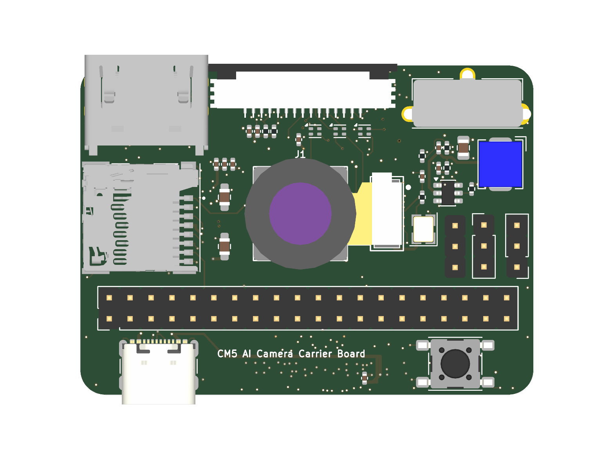
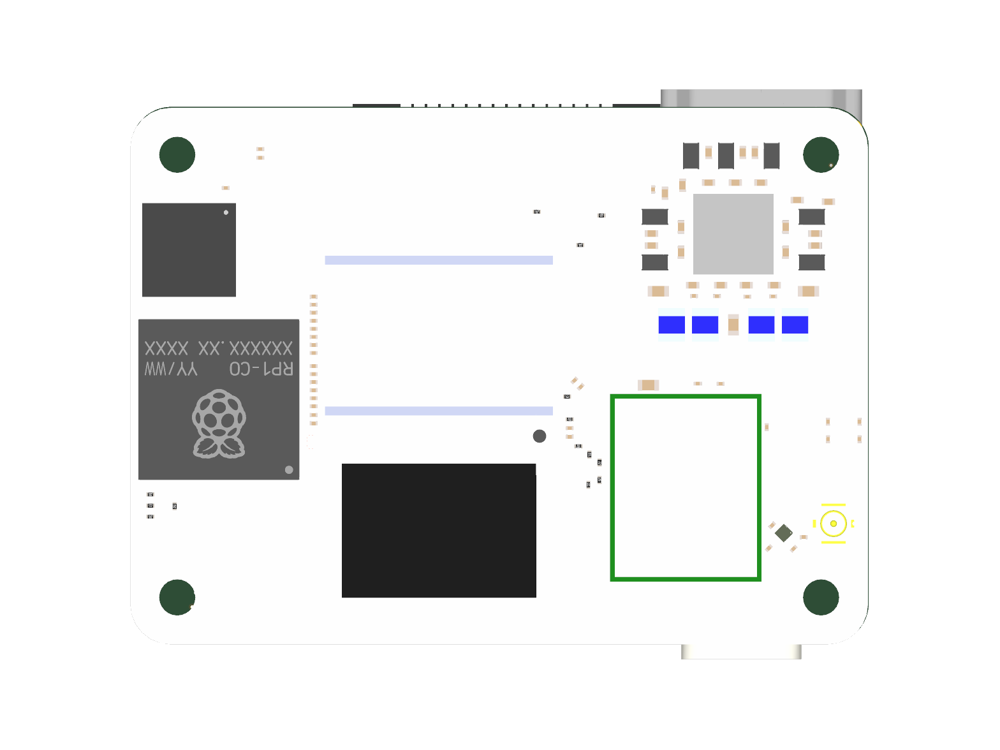
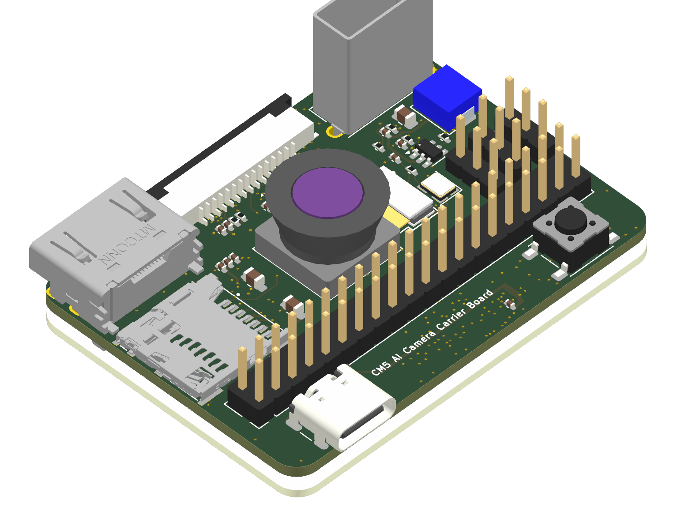
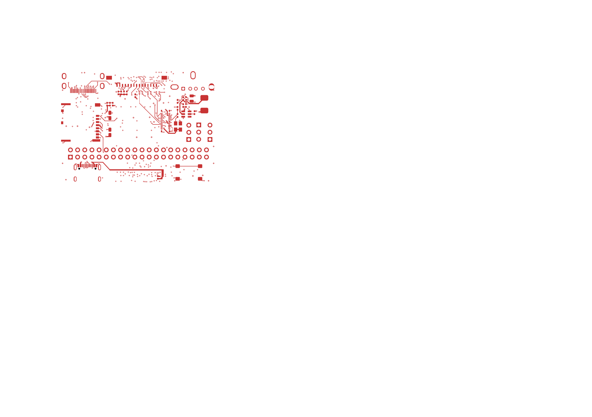

# CM5 AI Camera Carrier Board: 6-Layer Edge AI Vision Platform

[](CM5-AI-Cam-CopperPilot.kicad_pro)
[](review/final/drc.rpt)
[](review/final/erc.rpt)
[](manufacturing/ORDER_SPEC.md)
[](tests/)
[](LICENSE)

An ultra-compact, high-density, 6-layer carrier board designed for the **Raspberry Pi Compute Module 5 (CM5)**, purpose-built for embedded computer vision, edge AI inference, autonomous robotics, and smart camera applications. Engineered in an exact 55.0 mm × 40.0 mm form factor matching the CM5 module dimensions, the board provides dedicated low-noise power rails, matched 90 Ω / 100 Ω differential MIPI CSI-2/DSI and HDMI routing, onboard common-mode filtering, high-speed peripheral multiplexing, and standard 40-pin Raspberry Pi GPIO expansion.

---

## 3D Hardware Presentation

| Top Isometric View | Bottom Mezzanine View |
|:---:|:---:|
|  |  |

| Full System Isometric | Top Routing (F.Cu) |
|:---:|:---:|
|  |  |

---

## System Architecture

```
                    +-------------------------------------------------------+
                    |                      Power Entry                      |
                    | USB-C (Type_C1) w/ 5.1k CC (R2, R3) OR 40-Pin PI1 Header
                    |                             |                         |
                    |               MPS MP1658 3.3V / 3A Buck (U5)          |
                    |                             |                         |
                    |     +-----------------------+-------------------+     |
                    |     |                       |                   |     |
                    | RT9193-2.8V (U1)    RT9193-1.8V (U2)    RT9013-1.2V (U3)
                    +-----+-----------------------+-------------------+-----+
                          |                       |                   |
                     CAM_2V8 Rail            CAM_1V8 Rail        CAM_1V2 Rail
                          |                       |                   |
+-------------------------v-----------------------v-------------------v-----+
|                         Camera Imaging Subsystem                          |
| 30-Pin Sony IMX219 Autofocus Camera Connector (J1)                        |
| 3x Coilank ACM1210 High-Frequency Common-Mode Chokes (L1, L2, L3)         |
| 2-Lane MIPI CSI-2 (90 Ω Differential, Length-Matched Striplines)          |
+---------------------------------------------+-----------------------------+
                                              |
                          Mezzanine DF40C     | MIPI CSI-2
                          Mezzanine DF40C     | (High-Speed Imaging)
+---------------------------------------------v-----------------------------+
|                     Raspberry Pi Compute Module 5 (Module1)               |
| Dual 100-Pin Mezzanine Connectors (Hirose DF40C-100DS-0.4V)                |
| Broadcom BCM2712 Quad-Core Cortex-A76 @ 2.4 GHz, LPDDR4X SDRAM, PCIe 2.0  |
+------+--------------+---------------+---------------+--------------+------+
       |              |               |               |              |
  HDMI |         DSI  |          USB  |         SDIO  |         GPIO |
+------v-------+ +----v---------+ +---v---------+ +---v--------+ +---v------+
| Mini-HDMI-C  | | 15-Pin DSI   | | FSUSB42 Mux | | MicroSD    | | 40-Pin   |
| (HDMI1) w/   | | Display Rib- | | (U6) to     | | Slot (TF1) | | GPIO     |
| STMPS2171    | | bon (DSI1) w/| | USB-A (J2)  | | w/ Power   | | Header   |
| Switch (U4)  | | Switch (U8)  | | & Type-C    | | Switch(U7) | | (PI1)    |
+--------------+ +--------------+ +-------------+ +------------+ +----------+
```

---

## Reference Design Attribution & Technical Improvements

This design was developed using the architecture and schematic concepts of the **Waveshare CM4 / CM5 Nano Base Board (C)** as an engineering reference. While that board provided an initial topological concept, our team conducted a thorough design review and implemented major electrical, mechanical, signal integrity, and manufacturing improvements to transform it into a fully validated, production-ready edge AI camera carrier.

### Summary of Key Engineering Improvements

| Domain | Baseline Reference Limitation | Implemented Engineering Improvement | Benefit / Impact |
|---|---|---|---|
| **Power Regulation** | Faulty feedback divider on 3.3V buck regulator U5 (MP1658) producing **4.84 V overvoltage**; unstable bootstrap configuration. | Redesigned feedback divider with precision 61.9 kΩ ±1% (R20) and 20.0 kΩ ±1% (R21) resistors for exact **3.305 V** output; corrected BST-to-SW capacitor network (C24). | Eliminates catastrophic overvoltage risk to Compute Module 5 core logic and 3.3V peripheral rails. |
| **Camera Power Tree** | Shared, noisy power distribution to camera sensor. | Implemented dedicated 3-rail low-noise LDO power distribution (`U1` 2.8V analog, `U2` 1.8V I/O, `U3` 1.2V core) with independent LC/ferrite filtering and high PSRR. | Minimizes power supply ripple and digital switching noise for high-definition, low-noise CMOS image capture. |
| **Signal Integrity (MIPI CSI-2)** | Differential common-mode chokes (L1, L2, L3) had inverted pin assignments (pins 2 and 4 swapped relative to physical coil windings). | Corrected choke symbol pins to match physical Coilank ACM1210 / MCF1210 windings; routed 90 Ω differential striplines on inner layer `In2.Cu` between uninterrupted ground planes (`In1.Cu`, `In3.Cu`). | Eliminates P/N differential inversions and dead-shorts across clock/data lanes; provides clean return paths with zero plane slotting. |
| **USB Architecture** | Unsynchronized FSUSB42 switch pinout and ambiguous host/device selection logic. | Corrected UMLP-10 pin assignments for FSUSB42UMX (`U6`) and routed USB 2.0 differential pairs to allow hardware selection between USB-C device mode (`rpiboot`) and vertical USB-A host port. | Enables seamless eMMC OS flashing over USB-C and full USB 2.0 host peripheral support. |
| **Display Shielding** | DSI 15-pin FPC connector symbol pin SH had no matching pad on footprint, leaving mechanical ground tabs floating. | Updated symbol pin mapping to match physical footprint mounting pads (`MP`), securely tying connector shield tabs to chassis ground. | Eliminates KiCad DRC net conflict and provides reliable EMI shielding for high-speed DSI display ribbons. |
| **DFM & Clearances** | Tight via-to-via clearance (0.0718 mm) accommodated by relaxing custom rules below manufacturer limits. | Nudged GND via at `(55.65, 61.41)` to expand clearance to 0.180 mm; updated `.kicad_dru` to strictly enforce JLCPCB standard minimum clearance (≥ 0.150 mm). | Guarantees high manufacturing yield and prevents solder bridging / drill breakout during multilayer fabrication. |
| **Turnkey PCBA Sourcing** | Incomplete BOM with missing part numbers; accidental `(dnp yes)` attributes on USB-C power entry and mezzanine sockets. | 100% pre-sourced in-stock LCSC part numbers across all 42 BOM lines (90 placed components); cleared erroneous DNP flags; standardized footprints (SOT-523 for Q1/Q2, SOT-563 for U5). | Ready for immediate, 100% automated turnkey fabrication and double-sided SMT assembly at JLCPCB. |
| **Automated Testing** | No automated regression test suite or formal design verification harness. | Implemented a 25-point automated PyTest verification suite (`tests/test_pcb.py`), 11-stage hardware verification runner (`review/verify.sh`), and unified `Makefile`. | Enables continuous verification of physical dimensions, layer stackups, DRC/ERC parity, and manufacturing readiness. |

---

## Hardware Specifications

- **Form Factor & Dimensions:** 55.0 mm × 40.0 mm matching the Raspberry Pi Compute Module mechanical standard, with 3.0 mm corner radii and 4x M2.5 mounting holes.
- **Compute Module Mezzanine:** Dual Hirose DF40C-100DS-0.4V(51) 100-pin connectors with 0.40 mm pitch providing high-speed interconnects for CSI-2, DSI, HDMI TMDS, USB 2.0, SDIO, and PCIe.
- **Power Subsystem:**
  - **Main Input:** 5.0 V DC via USB Type-C receptacle (`Type_C1`, GCT USB4105-GF-A) or via 40-pin GPIO expansion header (`PI1`). Recommended power supply: 5V / 3A minimum.
  - **Type-C Configuration:** Dual 5.1 kΩ ±1% CC pull-down resistors (`R2`, `R3`) for standard 5V/3A Power Delivery source negotiation.
  - **3.3 V System Rail:** Monolithic Power Systems MP1658GTF-Z synchronous buck converter (`U5`) delivering up to 3.0 A continuous output current, filtered by Bourns SRP5030CC 4.7 µH shielded power inductor (`L7`) and low-ESR ceramic output capacitors.
  - **Low-Noise Camera Power Tree:**
    - `CAM_2V8`: 2.8 V analog rail via Richtek RT9193-28GB LDO (`U1`) with high PSRR for CMOS sensor core.
    - `CAM_1V8`: 1.8 V digital I/O rail via Richtek RT9193-18GB LDO (`U2`).
    - `CAM_1V2`: 1.2 V core logic rail via Richtek RT9013-12 LDO (`U3`).
- **Camera Imaging Subsystem:**
  - 30-pin 0.5 mm pitch FPC receptacle (`J1`) designed for Sony IMX219 (Raspberry Pi Camera V2) and compatible sensor modules.
  - Three Coilank ACM1210 / MCF1210 common-mode chokes (`L1`, `L2`, `L3`) placed on MIPI CSI-2 clock and data lanes for high-frequency common-mode noise suppression.
  - Controlled 90 Ω differential impedance routing with matched electrical lengths and continuous reference ground planes.
- **Video & Display Interfaces:**
  - **Mini-HDMI Type-C:** Molex 47151-0001 connector (`HDMI1`) with dedicated 5 V power distribution switch (`U4`, STMPS2171STR) and hot-plug detection.
  - **MIPI DSI Display:** 15-pin 1.0 mm pitch Molex 200528-0150 horizontal connector (`DSI1`) with STMPS2171 power switch (`U8`).
- **Storage & Communication:**
  - **MicroSD Card:** Molex 503398-1892 push-push card socket (`TF1`) with dedicated STMPS2171 3.3 V load switch (`U7`) for clean power-cycling and card detection.
  - **USB Architecture:** Vertical USB 2.0 Type-A host port (`J2`, Molex 67298-4090) and USB Type-C peripheral port routed through ON Semi FSUSB42MX high-speed analog switch (`U6`).
- **User Interface & Clocks:**
  - 24.0 MHz precision crystal oscillator (`X1`, 3225 package) for peripheral synchronization.
  - Tactile user push-button (`Key1`, PTS645) connected to GPIO.
  - Status LEDs: 0603 Red Power LED (`L5`) and Green Activity LED (`L6`).

---

## Getting Started & Operating Guide

### 1. Mounting the Compute Module 5
1. Align the Compute Module 5 over the dual Hirose DF40C mezzanine connectors on the bottom side (`B.Cu`).
2. Gently apply uniform downward pressure across the center of the module until both 100-pin connectors click firmly into place.
3. Fasten the module using M2.5 screws and 1.5 mm to 3.0 mm standoffs through the four corner mounting holes.

### 2. Powering the Carrier Board
- **Primary Power (USB-C):** Connect a regulated 5.0 V / 3.0 A USB-C power supply to receptacle `Type_C1`. The onboard CC termination resistors (`R2`, `R3`) negotiate standard 5V operation from USB Power Delivery sources.
- **Alternative Power (GPIO Header):** Connect a regulated 5.0 V DC supply to Pin 2 (`5V`) and Pin 6 (`GND`) of the 40-pin header (`PI1`).
- **Power Indicator:** The onboard red LED (`L5`) illuminates immediately when 5V input power is active.

### 3. Flashing Compute Module 5 eMMC
For CM5 modules equipped with onboard eMMC:
1. Connect the carrier board to a host PC using the USB Type-C port (`Type_C1`).
2. Ensure the boot selection jumper/signal drives `/nRPIBOOT` low to place the BCM2712 processor into USB bootloader mode.
3. Run the official Raspberry Pi `rpiboot` utility on the host computer:
   ```bash
   rpiboot
   ```
4. The CM5 eMMC storage will mount as a mass-storage device on your computer. Use Raspberry Pi Imager to flash Raspberry Pi OS or your desired Linux distribution.

### 4. Camera Configuration (Sony IMX219 / MIPI CSI-2)
1. Insert the 30-pin 0.5 mm pitch FPC camera ribbon into connector `J1` with the contacts facing down toward the board surface.
2. In Raspberry Pi OS, configure the camera overlay by editing `/boot/firmware/config.txt`:
   ```ini
   # Enable Sony IMX219 Camera Sensor
   dtoverlay=imx219
   ```
3. Reboot the system and verify camera enumeration using `rpicam-apps`:
   ```bash
   rpicam-hello --list-cameras
   rpicam-hello -t 5000
   ```

### 5. Display Configuration
- **Mini-HDMI (`HDMI1`):** Plug a standard Mini-HDMI to HDMI cable into `HDMI1`. Video output is automatically detected via EDID / HPD.
- **MIPI DSI Display (`DSI1`):** Connect a 15-pin 1.0 mm pitch DSI display ribbon cable to `DSI1`. Configure the matching display overlay in `/boot/firmware/config.txt` (e.g. `dtoverlay=vc4-kms-dsi-7inch`).

### 6. User Button & GPIO Header
- The tactile push-button (`Key1`) is wired directly to GPIO21 with a 10 kΩ pull-up to 3.3V. Pressing the button pulls GPIO21 low, allowing easy software-defined trigger or shutdown scripting.
- The 40-pin GPIO header (`PI1`) follows the standard Raspberry Pi 40-pin pinout, fully compatible with 3.3V HATs and expansion boards.

---

## 6-Layer PCB Stackup & Impedance Control

The board utilizes the industry-standard **JLCPCB JLC06161H-7628** 6-layer controlled-impedance stackup (1.6 mm nominal thickness):

| Layer | Type | Copper Weight | Thickness | Function / Routing Allocation |
|---|---|:---:|:---:|---|
| **1. F.Cu** | Signal | 1.0 oz (35 µm) | 0.035 mm | Primary SMT components, high-speed microstrip escapes, local ground pours |
| *Dielectric 1* | Prepreg (7628) | — | 0.210 mm | FR-4 ($\varepsilon_r \approx 4.6$) |
| **2. In1.Cu** | Plane | 0.5 oz (15.2 µm) | 0.0152 mm | **Continuous Ground Reference Plane** (Zero-reference for L1 & L3) |
| *Dielectric 2* | Core | — | 0.400 mm | FR-4 Core ($\varepsilon_r \approx 4.6$) |
| **3. In2.Cu** | Signal | 0.5 oz (15.2 µm) | 0.0152 mm | **Stripline High-Speed Routing** (MIPI CSI-2, DSI, HDMI TMDS, USB diff pairs) |
| *Dielectric 3* | Prepreg (7628) | — | 0.210 mm | FR-4 ($\varepsilon_r \approx 4.6$) |
| **4. In3.Cu** | Plane | 0.5 oz (15.2 µm) | 0.0152 mm | **Continuous Ground Reference Plane** (Zero-reference for L3 & L5) |
| *Dielectric 4* | Core | — | 0.400 mm | FR-4 Core ($\varepsilon_r \approx 4.6$) |
| **5. In4.Cu** | Mixed | 0.5 oz (15.2 µm) | 0.0152 mm | **Power Distribution Planes** (`+5V`, `+3.3V`, `CAM_2V8`, `CAM_1V8`, `CAM_1V2`) |
| *Dielectric 5* | Prepreg (7628) | — | 0.210 mm | FR-4 ($\varepsilon_r \approx 4.6$) |
| **6. B.Cu** | Signal | 1.0 oz (35 µm) | 0.035 mm | Mezzanine connectors, bypass decoupling network, ground pour |

### Controlled Impedance Targets
- **90 Ω Differential Stripline (In2.Cu):** Trace width 0.127 mm, spacing 0.150 mm (MIPI CSI-2, MIPI DSI, HDMI TMDS pairs, USB D+/D-).
- **50 Ω Single-Ended Stripline (In2.Cu):** Trace width 0.180 mm (High-speed single-ended clocks and control signals).
- **Manufacturing Margins:** Minimum trace width 0.09 mm, minimum clearance 0.09 mm, via drill 0.20 mm / pad 0.40 mm (exceeds standard JLCPCB capability).

---

## Repository Structure

```
.
├── Makefile                        # Unified build orchestrator (test, lint, drc, erc, fab)
├── .gitignore                      # Clean Git exclusion specification
├── LICENSE                         # CERN Open Hardware Licence v2 - Strongly Reciprocal
├── README.md                       # Comprehensive hardware specifications & documentation
├── CM5-AI-Cam-CopperPilot.kicad_pro# KiCad 10 project definition & net classes
├── CM5-AI-Cam-CopperPilot.kicad_sch# Complete multi-block schematic capture
├── CM5-AI-Cam-CopperPilot.kicad_pcb# 6-layer PCB layout (100% routed, 0 DRC violations)
├── CM5-AI-Cam-CopperPilot.kicad_dru# Custom design rules & clearance definitions
├── CM5.kicad_sym                   # Project-local schematic symbol library
├── sym-lib-table                   # Project symbol library registry (${KIPRJMOD})
├── fp-lib-table                    # Project footprint library registry (${KIPRJMOD})
├── CM5.pretty/                     # Self-contained project-local footprint library
├── CM5.3dshapes/                   # 3D mechanical models (STEP/WRL)
├── 3dmodels/                       # Mezzanine reference CAD models
├── docs/                           # Documentation assets and renders
│   └── images/                     # 3D renders, layer graphics, and mechanical diagrams
├── tests/                          # Automated 25-point PyTest hardware verification suite
│   ├── conftest.py                 # S-expression AST parsers & KiCad CLI fixtures
│   └── test_pcb.py                 # 25 automated hardware assertion tests
├── review/                         # Formal review deliverable & visual diff collateral
│   ├── index.html                  # Interactive visual review report & issue cards
│   ├── verify.sh                   # Automated acceptance test runner (T1 - T11)
│   ├── issues.json                 # Machine-readable issue register (15/15 verified)
│   ├── DECISIONS.md                # Engineering decision records & trade-offs
│   ├── SURVEY.md                   # Systematic schematic & PCB survey report
│   ├── READINESS.md                # Release readiness sign-off checklist
│   └── renders/                    # Baseline, final, and differential layer renders
└── jlcpcb_production/              # JLCPCB manufacturing release bundle
    ├── gerbers_jlcpcb.zip          # Production-ready RS-274X Gerbers and NC drill files
    ├── assembly/
    │   ├── bom_jlcpcb.csv          # Assembled BOM with 100% assigned LCSC part numbers
    │   └── cpl_jlcpcb.csv          # Pick-and-place centroid coordinates & rotations
    ├── gerbers/                    # Uncompressed Gerber and Excellon drill layers
    └── netlist/                    # IPC-D-356 electrical test netlist
```

---

## Automated Verification & Testing

The repository includes a comprehensive, multi-tiered test infrastructure running both unit-level hardware property tests and full-design acceptance validations.

### Quick Start: Verification Commands

```bash
# Run the complete test and linting pipeline
make all

# Run the 25-point automated PyTest hardware test suite
make test

# Run KiCad Electrical Rule Check (ERC) and Design Rule Check (DRC)
make erc
make drc

# Run the full 11-stage hardware acceptance test runner
make verify

# Rebuild the interactive visual review report
make report

# Generate and package production Gerbers, drill files, BOM, and CPL
make fab
```

### 25-Point PyTest Hardware Test Matrix (`tests/test_pcb.py`)

| Test Group | Test Case | Target / Specification | Result |
|---|---|---|:---:|
| **Board Physical** | `test_board_dimensions` | 55.0 mm × 40.0 mm (±0.5 mm tolerance) | **PASS** |
| | `test_board_outline_closed` | Continuous closed `Edge.Cuts` boundary with rounded corners | **PASS** |
| | `test_layer_stackup_6layer` | 6 copper layers (`F.Cu`, `In1-4.Cu`, `B.Cu`) | **PASS** |
| | `test_board_thickness_nominal` | Nominal board thickness of 1.6 mm | **PASS** |
| **Connectivity & Parity** | `test_drc_zero_errors` | KiCad CLI DRC: 0 errors, 0 warnings | **PASS** |
| | `test_drc_zero_unconnected_items` | 100% routed copper (0 unconnected airwires) | **PASS** |
| | `test_drc_schematic_parity` | Zero netlist or component parity mismatches | **PASS** |
| | `test_erc_zero_errors_and_warnings` | KiCad CLI ERC: 0 errors, 0 warnings | **PASS** |
| | `test_power_distribution_nets_present`| `GND`, `5V`, `3V3` power distribution nets verified | **PASS** |
| | `test_camera_subsystem_nets_present` | Dedicated camera rails (`/2V8`, `/1V8`, `/1V2`) verified | **PASS** |
| | `test_usb_differential_nets_present` | High-speed USB differential pairs verified | **PASS** |
| **Trace Geometry & DFM** | `test_signal_trace_min_width` | Trace width ≥ 0.09 mm (JLCPCB 6-layer capability) | **PASS** |
| | `test_power_trace_widths` | Power trace width ≥ 0.15 mm (low impedance) | **PASS** |
| | `test_via_drill_and_pad_dimensions` | Via drill ≥ 0.20 mm, pad diameter ≥ 0.40 mm | **PASS** |
| | `test_via_annular_rings` | Via annular rings ≥ 0.10 mm | **PASS** |
| **Subsystem Circuits** | `test_cm5_module_footprint_present` | Hirose DF40 100-pin mezzanine footprint verified | **PASS** |
| | `test_camera_subsystem_chokes` | Common-mode chokes L1, L2, L3 populated | **PASS** |
| | `test_camera_ldos_present` | Dedicated camera LDOs U1, U2, U3 populated | **PASS** |
| | `test_buck_regulator_present` | MP1658 3.3V/3A synchronous buck regulator U5 populated | **PASS** |
| | `test_usb_c_cc_termination_resistors`| 5.1 kΩ pull-down resistors R2, R3 on CC pins | **PASS** |
| | `test_peripherals_present` | Connectors HDMI1, DSI1, TF1, PI1, Type_C1, J2 verified | **PASS** |
| **Repo Hygiene & DFM** | `test_no_absolute_user_paths_in_tables` | Zero user machine path leaks; 100% relative paths | **PASS** |
| | `test_manufacturing_bom_completeness` | BOM complete with 100% assigned LCSC part numbers | **PASS** |
| | `test_manufacturing_cpl_completeness` | CPL centroid coordinates and rotation offsets verified | **PASS** |
| | `test_gerber_package_files` | All 6 copper layers, mask, silk, paste, and drill files | **PASS** |

---

## Interactive Visual Review Deliverable

An interactive, self-contained HTML review deliverable is available at [`review/index.html`](review/index.html).

Key features of the report:
- **Zero Unexplained Changes:** Every modified region on every sheet and layer maps to a verified issue ID.
- **Layer-by-Layer Visual Diff Viewer:** Interactive comparison between baseline and release candidate for all 6 copper layers, silkscreens, solder masks, and schematic.
- **Detailed Issue Cards:** 15 tracked and verified issues with side-by-side Before/After/Diff image crops, engineering rationales, and git commit references.
- **Full Parity & Acceptance Scoreboard:** Live compliance status across tests T1 through T11.

---

## Manufacturing & Ordering Guide (JLCPCB)

To order fabricated and assembled boards directly from JLCPCB:

1. **PCB Fabrication:**
   - Upload `jlcpcb_production/gerbers_jlcpcb.zip`.
   - **Dimensions:** 55.0 mm × 40.0 mm.
   - **Layer Count:** 6 Layers.
   - **Impedance Control:** Yes — Select Stackup **JLC06161H-7628**.
   - **Surface Finish:** ENIG (Electroless Nickel Immersion Gold) recommended for high-density 0.4 mm pitch mezzanine pads.
   - **Copper Weight:** 1 oz outer / 0.5 oz inner.
   - **Solder Mask / Silkscreen:** Green mask / White silkscreen (or color of choice).
2. **SMT Assembly (PCBA):**
   - **Assembly Type:** Standard PCBA.
   - **Assembly Side:** Top and Bottom.
   - **BOM File:** Upload `jlcpcb_production/assembly/bom_jlcpcb.csv`.
   - **CPL / Centroid File:** Upload `jlcpcb_production/assembly/cpl_jlcpcb.csv`.
3. **Complete Order Spec:** Refer to [`manufacturing/ORDER_SPEC.md`](manufacturing/ORDER_SPEC.md) for full order form field values.

---

## License

This project is licensed under the **CERN Open Hardware Licence Version 2 - Strongly Reciprocal** ([CERN-OHL-S-2.0](LICENSE)).
